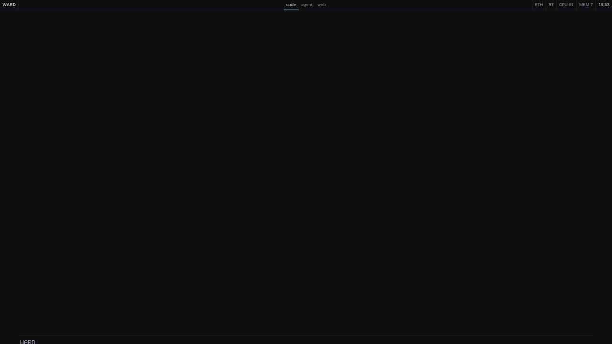

<p align="center">
  
</p>

<h1 align="center">WardOS</h1>

<p align="center"><strong>A secure Linux workstation and execution runtime for coding agents.</strong></p>

WardOS lets coding agents work inside an isolated project environment while keeping
the host, policy, credentials, verifier and trusted state outside their authority.
It combines a Linux desktop, a portable session runtime and a node service for
bounded local or remotely driven execution.

| Component | Use it for |
| --- | --- |
| **WardOS distribution** | A Fedora bootc workstation with a Hyprland desktop, security status bar, Claude Code, Codex and TamperWard. |
| **Ward runtime** (`ward`, `wardd`, `ward-agent`) | Sandboxed agent sessions and independent verification on an existing Linux host. |
| **`ward-node`** | Signed, expiring task authority, isolated attempts, resource limits, receipts and evidence for a local issuer or external control plane. |

Local sessions need no remote service. An external control plane is built separately;
WardOS enforces authority and records evidence on the execution host.
See the [product and trust boundaries](docs/decisions/ADR-0029-product-split-fleet-trust-boundaries.md).



<sub>Captured from the shipped desktop in CI. This animation shows the interface;
agent execution, approvals and verification are covered by the runtime tests.
[Capture details](docs/desktop.md#the-readme-animation).</sub>

## Get started

**On an existing Linux host:** download the runtime tarball for `x86_64` or
`aarch64` from the [latest release](https://github.com/hexrift/WardOS/releases/latest).
Follow the [installation guide](docs/install.md) to verify the download and install
`ward`, `wardd` and `ward-agent`. The runtime requires `bubblewrap` and
unprivileged user namespaces; `ward doctor` reports missing prerequisites.

The optional [installer](install.sh) installs the latest runtime release into
`~/.local/bin` and checks its signed manifest when verification is available.
It reports checksum-only installs explicitly; `--require-provenance` refuses them.
See [release verification](docs/release-manifest.md) for prerequisites and manual checks.

**For the full workstation:** follow the [image guide](image/README.md).
Use a qcow2 image for a VM or a raw image for a USB trial. The installer ISO erases
the target disk. The image includes the desktop and agents; the standalone runtime
requires the agent CLI to be installed separately.

In your project on Linux:

```bash
ward doctor
ward vault set ANTHROPIC_API_KEY   # enter the key; it stays on the host
ward init                         # review and accept the proposed verification command
ward ready                        # check policy, tools, credentials and verification setup
ward prepare                      # prepare dependencies for the offline verifier
ward ready --baseline             # run the tests before the agent changes anything
ward claude                       # launch Claude Code inside the sandbox
ward verify                       # verify with protected inputs from the entry snapshot
ward ready --answers              # inspect reach, credentials, changes and verification
ward stop                         # end the session and seal its evidence log
```

For Codex, use `OPENAI_API_KEY`, `ward init --agent codex` and `ward codex`.
The [onboarding guide](docs/onboarding.md) explains setup and denied actions.
Use `ward watch` from another terminal to follow activity, and `ward pause` /
`ward resume` to intervene.

## How it works

- **Bounded execution.** Project policy becomes a capability manifest. Agents run in
  a sandbox with network access mediated by a host-side policy proxy.
- **Host-held credentials.** Supported model and GitHub credentials are injected
  through the proxy rather than exposed as long-lived secrets inside the sandbox.
- **Independent verification.** `ward verify` captures a candidate and runs offline,
  restoring protected tests and verification configuration from the entry snapshot.
  Editing those inputs in the worktree cannot redefine the verifier's checks.
- **Recorded evidence.** Content-addressed snapshots and a hash-chained event log
  support inspection and replay. The desktop shows verification freshness, approvals
  and temporary grants; agent reports remain labelled as claims.

WardOS supplies isolation and runtime primitives. TamperWard supplies protected
invariants, tamper detection and independent checks. The
[security model](docs/security-model.md) and [threat model](docs/threat-model.md)
define the guarantees, assumptions and limits.

## Status

**Phase 7 — authority, freshness, intervention**, as declared in
[`docs/status.toml`](docs/status.toml). See the [roadmap](docs/roadmap.md) and
[experiments](docs/experiments.md) for remaining work and measured results.

The current `main` includes the session runtime, offline verifier, desktop and
`ward-node` execution contract with cross-system acceptance tests. Node capabilities
include network allowlists, bounded output return, brokered credentials, approval
holds, hosted agent adapters and mutual TLS, enabled by the operator and constrained
by signed task authority.

The first local migration path is also implemented: `ward node migrate`,
`ward node serve` and `ward run --via-node`. The other session commands and desktop
still use the per-session runtime. Follow the [migration guide](docs/migration-to-node.md)
for compatibility and rollback, and the [node security limitations](docs/node-security-limitations.md)
before integrating a control plane.

`main` may contain changes newer than the latest release. Runtime and node tarballs
have separate versions, recorded together in the release manifest; the runtime
installer does not install the node service. See
[node installation](docs/node-integration-guide.md) and
[release readiness](docs/node-release-readiness.md).

## Documentation

| Start here | Guide |
| --- | --- |
| Installation and first session | [Install](docs/install.md) · [Onboarding](docs/onboarding.md) |
| Desktop commands, keys and themes | [Desktop](docs/desktop.md) |
| Components and trust boundaries | [Architecture](docs/architecture.md) · [Decision records](docs/decisions/) |
| Security guarantees and evidence | [Security model](docs/security-model.md) · [Threat model](docs/threat-model.md) · [Event model](docs/event-model.md) |
| Agent and TamperWard integration | [Agent integration](docs/agent-integration.md) · [TamperWard integration](docs/tamperward-integration.md) |
| Node protocol and control-plane clients | [Contract](docs/node-integration.md) · [Integration guide](docs/node-integration-guide.md) · [Node.js / TypeScript](docs/node-integration-from-nodejs.md) |
| Node compatibility and acceptance | [Compatibility](docs/compatibility.md) · [Acceptance tests](docs/node-acceptance.md) |
| Plans and measurements | [Roadmap](docs/roadmap.md) · [Experiments](docs/experiments.md) · [Performance](docs/performance.md) |

## Contributing

See [CONTRIBUTING.md](CONTRIBUTING.md) for source builds, verification and pull requests,
and [SECURITY.md](SECURITY.md) to report a vulnerability.

## License

[Apache-2.0](LICENSE).
